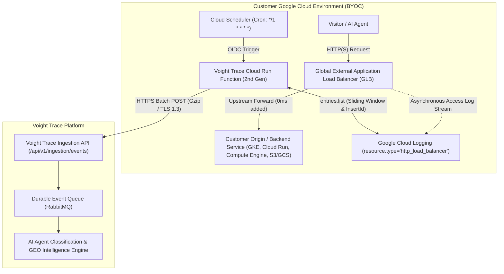

# GCP Collector — Architectural Specification & System Design

> **Document:** `01_architecture_and_design.md`  
> **Status:** Approved Production Specification  
> **Methodology:** Specification-Driven Development (SDD) & Docs-First  
> **Visibility:** Public & Client-Safe (Zero internal secrets, credentials, or proprietary infrastructure)

---

## 1. Executive Summary & Purpose

The **Voight Trace GCP Collector** (`@voight-trace/gcp-collector`) is an asynchronous, zero-latency edge observation collector designed specifically for applications routed through the **Google Cloud Global External Application Load Balancer (GLB)**.

Unlike traditional in-band proxy workers or synchronous Envoy callout extensions (which inject external network latency and create critical points of failure on the user request path), the GCP Collector leverages Google Cloud's native **Cloud Logging** telemetry pipeline. It executes as a **2nd Generation Cloud Run Function** scheduled periodically (e.g., every 1 minute) within the customer's own Google Cloud project (BYOC — Bring Your Own Cloud).

---

## 2. Core Architectural Pillars

### 2.1. Zero Latency Overhead (100% Out-of-Band)
* **The Problem with Synchronous Interception:** Calling an external API during request execution via Envoy External Processing (`ext_proc`) or proxy containers adds 50ms–300ms round-trip latency to every incoming hit.
* **The Solution:** GLB access logs are written asynchronously by Google Cloud's control plane to Cloud Logging. The collector reads these logs out-of-band. The end-user's response time is **100% unaffected (0ms added)**.

### 2.2. BYOC (Bring Your Own Cloud) Isolation
* The collector function and its scheduler execute **entirely inside the customer's Google Cloud project**.
* **Zero Cross-Project IAM Permissions:** Voight Trace never requests access to the customer's Google Cloud project. No service account keys are exported or shared across organizations.
* All data sanitization and privacy filtering occur **locally at the source** before any batch is transmitted to Voight Trace.

### 2.3. Zero-Persistence Stateless Design
* The Cloud Run Function requires **no database, no Firestore, and no Redis** in the customer's project.
* Instead of maintaining an external database cursor for `lastTimestamp`, the collector queries a sliding window with deterministic overlap:
  $$\text{Window} = [\text{CurrentTime} - (\text{Interval} + \text{OverlapSeconds}), \text{CurrentTime}]$$
* For example, with a 60-second schedule, the function reads the past 75 seconds. Any duplicated log entries resulting from the 15-second overlap are deduplicated idempotently by the Voight Trace Ingestion API using Google Cloud's unique `insertId`.

### 2.4. Resilient Delivery & Backoff
* If the Voight Trace Ingestion API experiences transient network degradation or brief downtime, the Cloud Run Function retries with exponential backoff and jitter.
* Because Cloud Logging retains logs for 30 days by default (in the `_Default` bucket), no observation is permanently lost.

---

## 3. Data Flow Step-by-Step

| Step | Component | Description |
| :---: | :--- | :--- |
| **1** | **GLB** | Receives an incoming request from an AI agent or human visitor, serves the response from the customer backend, and asynchronously commits an HTTP access log record to Cloud Logging. |
| **2** | **Cloud Scheduler** | Fires an authenticated HTTPS request (`POST`) to the Cloud Run Function once every 60 seconds using an internal Service Account OIDC token. |
| **3** | **Cloud Run Function** | Authenticates via Google Application Default Credentials (ADC) and calls `logging.getEntries()` filtered by `resource.type="http_load_balancer"` over the sliding time window. |
| **4** | **Sanitization Layer** | Parses each log entry's `httpRequest` object, applies the strict `SAFE_AUDIT_HEADERS` allowlist, and strips any cookies, auth tokens, or private request headers. |
| **5** | **Batch Dispatch** | Bundles transformed observations into the standardized Voight Trace Event Contract (`collector_type: "gcp_collector"`) and dispatches a single HTTPS POST to the Ingestion API. |

---

## 4. Architectural Boundaries & Non-Goals

* **Non-Goal: Request Blocking / WAF:** The GCP Collector is an observability and intelligence tool. It does not block or terminate requests at runtime (request mitigation is delegated to Google Cloud Armor or Cloudflare).
* **Non-Goal: Heavy Parsing at the Edge:** All complex AI model classification, reverse-DNS validation (FCrDNS), and SimilarWeb AI platform matching occur on the Voight Trace backend engines, keeping the Cloud Run Function lightweight, fast, and resource-efficient.
