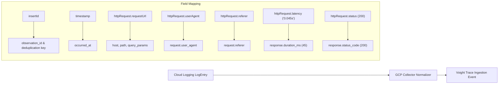

# Cloud Logging Specification, Schemas & Payload Mapping

> **Document:** `02_cloud_logging_spec_and_schemas.md`  
> **Status:** Approved Production Specification  
> **Reference:** Google Cloud Logging LogEntry & HTTP Load Balancer Access Logs  
> **Visibility:** Public & Client-Safe

---

## 1. Overview of GLB Access Logs in Cloud Logging

When logging is enabled on a Backend Service of a Google Cloud Global External Application Load Balancer (GLB), each request produces a structured `LogEntry` in Cloud Logging categorized under the resource type `http_load_balancer`.

### 1.1. Prerequisites on the Customer GLB
For Cloud Logging to record the access logs with full metadata, the target **Backend Service** on the GLB must have logging enabled:
* `logConfig.enable = true`
* `logConfig.sampleRate = 1.0` (or the desired sampling ratio between 0.0 and 1.0)
* Optional: `logConfig.optionalFields = ["custom_headers"]` if customer-configured response/request headers are monitored.

If logging is not enabled on the Backend Service, queries to `entries.list` will return `200 OK` with an empty entry list `[]`.

---

## 2. Google Cloud `LogEntry` Schema for `http_load_balancer`

Below is the authoritative JSON schema structure of an incoming Cloud Logging record emitted by Google Cloud Load Balancing:

```json
{
  "insertId": "1b2c3d4e5f6g7h8i9j0k",
  "httpRequest": {
    "requestMethod": "GET",
    "requestUrl": "https://example.com/pricing?ref=chatgpt",
    "requestSize": "428",
    "status": 200,
    "responseSize": "14280",
    "userAgent": "Mozilla/5.0 (Macintosh; Intel Mac OS X 10_15_7) ...",
    "remoteIp": "203.0.113.195",
    "referer": "https://chatgpt.com/",
    "latency": "0.045120s",
    "protocol": "HTTP/2"
  },
  "resource": {
    "type": "http_load_balancer",
    "labels": {
      "project_id": "customer-production-project",
      "url_map_name": "glb-url-map",
      "backend_service_name": "backend-service-frontend",
      "target_proxy_name": "glb-target-https-proxy",
      "forwarding_rule_name": "glb-forwarding-rule-https",
      "zone": "global"
    }
  },
  "timestamp": "2026-11-24T09:25:00.123456Z",
  "receiveTimestamp": "2026-11-24T09:25:01.054321Z",
  "severity": "INFO",
  "logName": "projects/customer-production-project/logs/requests"
}
```

### 2.1. Key Field Definitions

| Field Name | Type | Description |
| :--- | :--- | :--- |
| `insertId` | `string` | Unique log entry identifier assigned by Google Cloud. Used for **idempotent deduplication**. |
| `timestamp` | `string` (RFC 3339) | The exact UTC time when the request was completed by the GLB. |
| `httpRequest.requestMethod` | `string` | HTTP verb: `GET`, `POST`, `HEAD`, `PUT`, `DELETE`, `OPTIONS`. |
| `httpRequest.requestUrl` | `string` | Full requested URL including scheme, host, path, and query parameters. |
| `httpRequest.status` | `number` | Final HTTP response status code (e.g. `200`, `301`, `403`, `502`). |
| `httpRequest.userAgent` | `string` | Client User-Agent string. Primary vector for **AI Bot & Crawler detection**. |
| `httpRequest.referer` | `string` | Referer URL. Primary vector for **GEO & AI Referral detection** (ChatGPT, Perplexity, Claude). |
| `httpRequest.remoteIp` | `string` | Client IP address observed by the edge proxy. |
| `httpRequest.latency` | `string` | Round-trip processing time formatted as seconds with suffix (e.g., `"0.024500s"`). |
| `httpRequest.responseSize` | `string\|number` | Payload size transmitted to the client in bytes. |

---

## 3. Querying Cloud Logging: The Filter Expression

The collector queries Cloud Logging via the official Node.js SDK (`@google-cloud/logging`) using `logging.getEntries()`.

### 3.1. Optimized Filter Syntax
```sql
resource.type="http_load_balancer" 
AND timestamp >= "${startTimeISO}" 
AND timestamp <= "${endTimeISO}"
```

### 3.2. Bot-Optimized Secondary Filter (Optional)
To reduce Cloud Logging read volume and optimize bandwidth, the query can optionally filter out non-informative assets (like images, fonts, static bundles) or requests without User-Agent:
```sql
resource.type="http_load_balancer" 
AND timestamp >= "${startTimeISO}" 
AND httpRequest.userAgent:*
```

---

## 4. Normalization & Mapping to Voight Trace Event Contract

The collector transforms each Cloud Logging `LogEntry` into the standard Voight Trace observation payload (`collector_type: "gcp_collector"`).



### 4.1. Concrete Transformed Event JSON

```json
{
  "event_id": "e4f8d9c2-5b1a-4c3e-8f2a-1b0c9d8e7f6a",
  "event_type": "http.request",
  "schema_version": 1,
  "tenant_id": "018f2d5e-7a91-7f82-a312-d81b9542a301",
  "site_id": "018f2d5e-7a91-7f82-a312-d81b9542a301",
  "collector_id": "gcp_glb_us_central1",
  "collector_type": "gcp_collector",
  "observation_id": "1b2c3d4e5f6g7h8i9j0k",
  "correlation_id": "vgt_1b2c3d4e5f6g7h8i9j0k",
  "occurred_at": "2026-11-24T09:25:00.123Z",
  "request": {
    "method": "GET",
    "scheme": "https",
    "host": "example.com",
    "path": "/pricing",
    "query_params": {
      "ref": "chatgpt"
    },
    "referer": "https://chatgpt.com/",
    "user_agent": "Mozilla/5.0 ...",
    "selected_headers": {
      "accept": "text/html,application/xhtml+xml",
      "accept-language": "en-US,en;q=0.9"
    }
  },
  "network": {
    "ip_hash": "203.0.113.195",
    "country": "XX",
    "asn": 0
  },
  "response": {
    "status_code": 200,
    "duration_ms": 45,
    "bytes_sent": 14280
  }
}
```

### 4.2. Latency Conversion Formula
Google Cloud Logging represents latency as a string with second units (e.g., `"0.045120s"`). The collector parses this deterministically into integer milliseconds:
$$\text{duration\_ms} = \operatorname{Math.round}(\operatorname{parseFloat}(\text{latency}) \times 1000)$$
