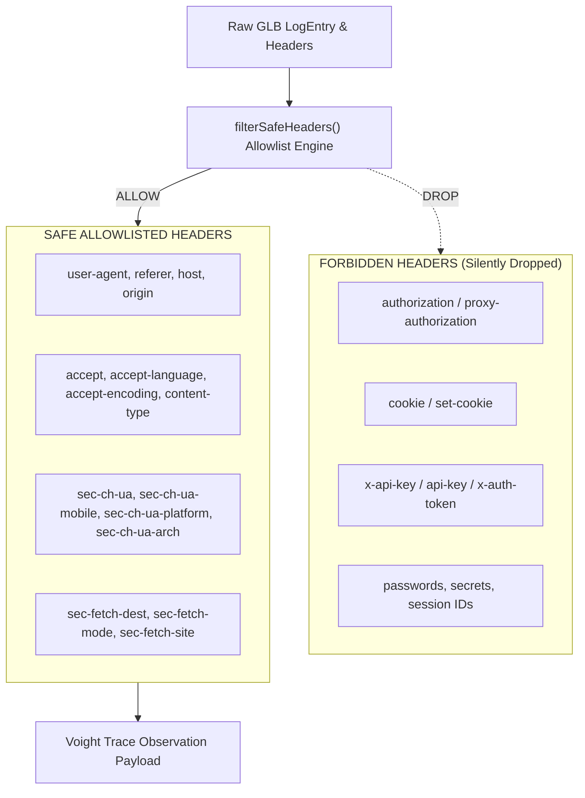

# Cloud Logging Specification, Schemas & Payload Mapping

> **Document:** `02_cloud_logging_spec_and_schemas.md`  
> **Status:** Approved Production Specification  
> **Reference:** Google Cloud Logging LogEntry & Global External Application Load Balancer (GLB) Access Logs  
> **Monitored Resource:** `resource.type="http_load_balancer"`  
> **Visibility:** Public & Client-Safe  

---

## 1. Overview of GLB Access Logs in Cloud Logging

When logging is enabled on a Backend Service of a Google Cloud Global External Application Load Balancer (GLB), each client request processed by the Google Front End (GFE) edge produces a structured `LogEntry` in Cloud Logging categorized under the monitored resource type `http_load_balancer`.

### 1.1. Prerequisites on the Customer GLB
For Cloud Logging to record access logs with full metadata:
1. **Enable Backend Service Logging:**
   * `logConfig.enable = true`
   * `logConfig.sampleRate = 1.0` (or customer sampling ratio, e.g., 0.5 - 1.0)
2. **Optional Custom Headers:**
   * Customers can optionally log custom request/response headers via `logConfig.optionalFields = ["custom_headers"]`.
3. **Cloud Armor Security Policies:**
   * When Google Cloud Armor is attached to the backend service or security policy, security decision metadata is automatically attached under `jsonPayload.enforcedSecurityPolicy` and `jsonPayload.securityPolicyRequestData`.

If logging is disabled on the Backend Service, queries to `logging.getEntries()` return `200 OK` with an empty entry list `[]`.

---

## 2. Google Cloud `LogEntry` Schema for `http_load_balancer`

Below is the authoritative JSON schema structure of an incoming Cloud Logging record emitted by Google Cloud Load Balancing:

```json
{
  "insertId": "1oek5rg3l3fxj7",
  "jsonPayload": {
    "@type": "type.googleapis.com/google.cloud.loadbalancing.type.LoadBalancerLogEntry",
    "statusDetails": "response_sent_by_backend",
    "cacheStatus": "MISS",
    "enforcedSecurityPolicy": {
      "name": "cloud-armor-rate-limit",
      "outcome": "ALLOW",
      "priority": 1000
    },
    "securityPolicyRequestData": {
      "clientRegion": "US"
    },
    "httpRequest": {
      "headers": {
        "accept": "text/html,application/xhtml+xml",
        "accept-language": "en-US,en;q=0.9",
        "sec-ch-ua": "\"Chromium\";v=\"132\""
      }
    }
  },
  "httpRequest": {
    "requestMethod": "GET",
    "requestUrl": "https://example.com/pricing?ref=chatgpt",
    "requestSize": "577",
    "status": 200,
    "responseSize": "14280",
    "userAgent": "Mozilla/5.0 (Macintosh; Intel Mac OS X 10_15_7) AppleWebKit/537.36 ...",
    "remoteIp": "203.0.113.195:48210",
    "serverIp": "10.128.0.4",
    "referer": "https://chatgpt.com/",
    "latency": "0.045120s",
    "protocol": "HTTP/2"
  },
  "resource": {
    "type": "http_load_balancer",
    "labels": {
      "project_id": "customer-production-project",
      "forwarding_rule_name": "glb-forwarding-rule-https",
      "target_proxy_name": "glb-target-https-proxy",
      "url_map_name": "glb-url-map",
      "backend_service_name": "backend-service-frontend",
      "zone": "global"
    }
  },
  "timestamp": "2026-11-24T09:25:00.123456Z",
  "receiveTimestamp": "2026-11-24T09:25:01.054321Z",
  "severity": "INFO",
  "logName": "projects/customer-production-project/logs/requests"
}
```

---

## 3. Detailed Field Specifications & Parsing Rules

### 3.1. Standard `httpRequest` Object
The `httpRequest` object adheres to the Google Cloud Logging standard protocol definition:

| Field Name | Type | Description | Collector Handling |
| :--- | :--- | :--- | :--- |
| `requestMethod` | `string` | HTTP verb (e.g. `GET`, `POST`, `OPTIONS`). | Normalized to uppercase (`request.method`). Default: `"GET"`. |
| `requestUrl` | `string` | Full requested URL (e.g. `https://example.com/api?q=1`) or path. | Parsed via `URL` constructor into `scheme`, `host`, `path`, and `query_params`. Default host fallback supported. |
| `status` | `number\|string` | Final HTTP response code (e.g. `200`, `403`, `504`). | Coerced to positive integer (`response.status_code`). Default: `200`. |
| `userAgent` | `string` | Client User-Agent string. | Mapped to `request.user_agent` & `selected_headers['user-agent']`. Primary vector for **AI Bot & Crawler detection**. |
| `referer` | `string` | Client HTTP referer header. | Mapped to `request.referer` & `selected_headers['referer']`. Primary vector for **GEO & AI Referral detection**. |
| `remoteIp` | `string` | Client IP address observed by GFE edge proxy. May contain port suffix (`198.51.100.25:48210` or `[2001:db8::1]:8080`). | Port suffix stripped; clean IPv4/IPv6 assigned to `network.ip_hash`. |
| `latency` | `string\|number\|object` | Round-trip processing time. Formatted as seconds with `s` suffix (e.g., `"0.045120s"`), numeric float, or protobuf Duration. | Parsed deterministically into integer milliseconds (`response.duration_ms`). |
| `responseSize` | `number\|string` | Payload size transmitted to client in bytes. | Coerced to integer (`response.bytes_sent`). Default: `0`. |

### 3.2. Detailed Taxonomy of `jsonPayload.statusDetails`
Google Cloud Load Balancer populates `jsonPayload.statusDetails` to explain the routing lifecycle and root cause:

| `statusDetails` Value | Associated HTTP Status | Semantic Meaning |
| :--- | :--- | :--- |
| `response_sent_by_backend` | `200-599` | Normal proxy execution: response was generated and returned by origin backend application. |
| `response_from_cache` | `200`, `304` | Request served directly from Google Cloud CDN edge cache (0 origin latency). |
| `byte_range_caching` | `206` | Cloud CDN partial content byte-range caching. |
| `denied_by_security_policy` | `403` | Request blocked at GFE edge by a Google Cloud Armor security policy. |
| `backend_timeout` | `504` | Origin backend failed to respond within configured GLB backend service timeout. |
| `failed_to_pick_backend` | `502` | No healthy backend instances or backend service group available to service request. |
| `handled_by_identity_aware_proxy`| `401`, `302` | Handled or redirected by Google Cloud Identity-Aware Proxy (IAP). |
| `internal_error` | `500` | Temporary Google Cloud Load Balancing edge infrastructure anomaly. |

### 3.3. Cloud Armor Security Policies & Geographic Region
When Cloud Armor evaluates a request, Google Cloud emits:
* `jsonPayload.enforcedSecurityPolicy`: `{ name, outcome: "ALLOW" | "DENY", priority }`
* `jsonPayload.securityPolicyRequestData.clientRegion`: Two-letter ISO country code (e.g. `"US"`, `"BR"`, `"DE"`), populated automatically by Google Cloud edge geo-IP resolution.
* **Collector Geo Resolution:** If `clientRegion` is present in `securityPolicyRequestData`, the collector prioritizes it for `network.country`. If absent, it gracefully falls back to the zone label or `"XX"`.

### 3.4. Custom Headers Handling
If custom headers are captured via GLB logging:
1. `jsonPayload.httpRequest.headers`: Key-value map of headers.
2. `jsonPayload.customHeaders`: Array of string pairs (`["Header-Name: value"]`) or object map.
3. Every custom header candidate is passed through `filterSafeHeaders()` to guarantee strict allowlist enforcement.

---

## 4. Querying Cloud Logging: The Filter Expression

The collector executes structured queries against Google Cloud Logging via the official `@google-cloud/logging` SDK:

```javascript
const filter = `resource.type="http_load_balancer" AND timestamp >= "${startTimeISO}" AND timestamp <= "${endTimeISO}"`;

const [entries] = await logging.getEntries({
  filter,
  pageSize: 1000,
  orderBy: 'timestamp asc'
});
```

### 4.1. Sliding Lookback Window
Cloud Scheduler executes the Cloud Run Function every 1 minute (`*/1 * * * *`). The collector computes:
$$\text{startTime} = \text{Date.now}() - (\text{LOOKBACK\_SECONDS} \times 1000)$$
$$\text{endTime} = \text{Date.now}()$$

With a default `LOOKBACK_SECONDS=75`, a 15-second overlap prevents any log ingestion gaps from GFE log delivery jitter. Idempotent deduplication on `observation_id` (`insertId`) ensures duplicates are safely ignored by the Voight Trace Ingestion API.

---

## 5. Security & Privacy: Allowlisted Safe Headers

The Voight Trace GCP Collector executes within the customer's BYOC environment. It guarantees zero leakage of private tokens or credentials:



---

## 6. Concrete Normalized Output: Voight Trace Event Contract

```json
{
  "event_id": "8a7f9b2c-3d4e-4f5a-8b1c-9d0e1f2a3b4c",
  "event_type": "http.request",
  "schema_version": 1,
  "tenant_id": "018f2d5e-7a91-7f82-a312-d81b9542a301",
  "site_id": "018f2d5e-7a91-7f82-a312-d81b9542a301",
  "collector_id": "gcp_glb_us_central1",
  "collector_type": "gcp_collector",
  "observation_id": "1oek5rg3l3fxj7",
  "correlation_id": "vgt_1oek5rg3l3fxj7",
  "occurred_at": "2026-11-24T09:25:00.123Z",
  "request": {
    "method": "GET",
    "scheme": "https",
    "host": "example.com",
    "path": "/pricing",
    "query_params": {
      "ref": "chatgpt"
    },
    "referer": "https://chatgpt.com/",
    "user_agent": "Mozilla/5.0 (Macintosh; Intel Mac OS X 10_15_7) ...",
    "selected_headers": {
      "user-agent": "Mozilla/5.0 (Macintosh; Intel Mac OS X 10_15_7) ...",
      "referer": "https://chatgpt.com/",
      "host": "example.com",
      "accept": "text/html,application/xhtml+xml",
      "accept-language": "en-US,en;q=0.9",
      "sec-ch-ua": "\"Chromium\";v=\"132\""
    }
  },
  "network": {
    "ip_hash": "203.0.113.195",
    "country": "US",
    "asn": 0
  },
  "response": {
    "status_code": 200,
    "duration_ms": 45,
    "bytes_sent": 14280
  }
}
```
